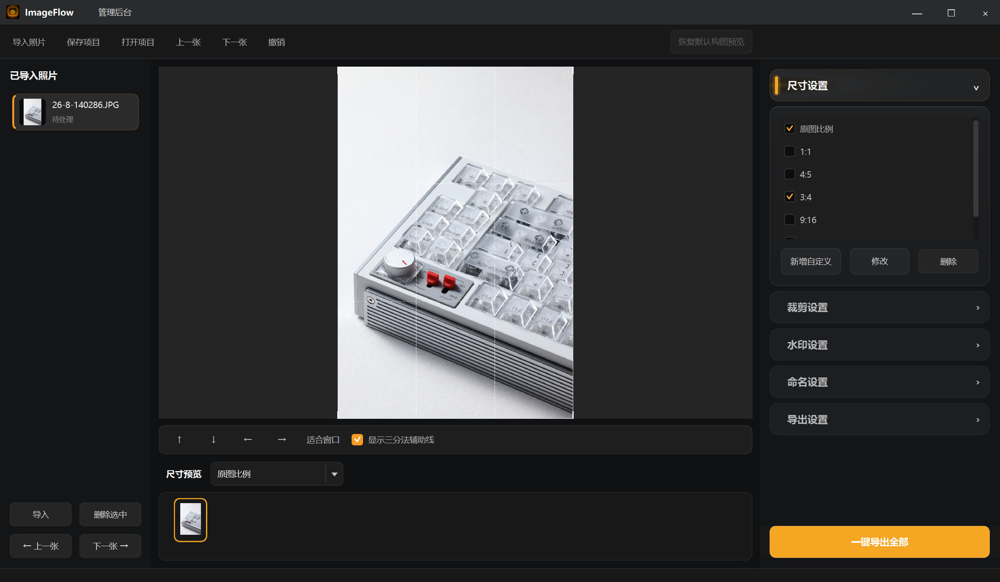
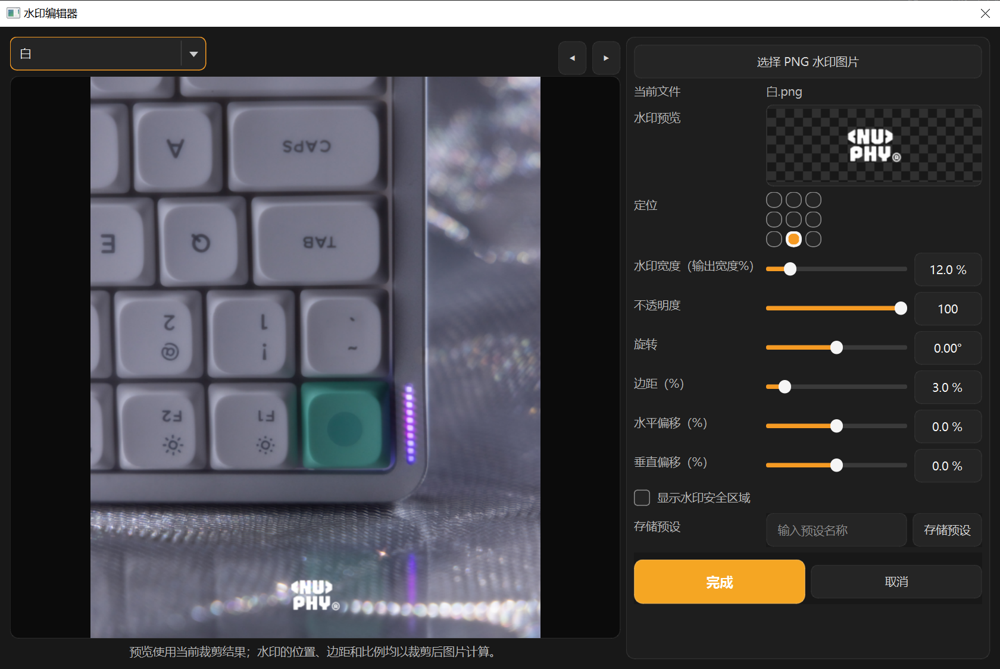

# ImageFlow

ImageFlow 是一款 Windows 桌面应用，将多尺寸裁剪、构图微调、水印、文件命名和批量导出集中在一个工作区中。所有编辑均以参数方式保存，**不会重命名、覆盖或修改导入的原始照片**。

## 界面预览

<p align="center">
  
</p>

<p align="center">
  
</p>

## 基本使用流程

Windows 和 macOS 上，点击窗口关闭按钮会将 ImageFlow 隐藏到系统托盘或菜单栏，程序继续运行。通过图标菜单可重新打开窗口或退出；Windows 也可点击图标打开窗口。如果系统托盘不可用，关闭窗口将正常退出。

1. 点击“导入照片”，选择需要交付的成片。
2. 在“尺寸设置”中勾选需要的比例，并从“尺寸预览”选择要编辑的尺寸。
3. 在画布中调整构图；在裁剪框内双击可查看裁剪后预览，再次双击或点击顶部“恢复默认构图预览”即可继续编辑。
4. 在画布中，按住 Alt 滚动鼠标滚轮可围绕鼠标位置缩放；按住空格并拖动鼠标左键可查看细节，“适合窗口”可恢复预览视图。这些操作不改变裁剪结果。
5. 在“水印设置”“命名设置”“导出设置”中配置输出规则。
6. 点击“一键导出全部”，将所有已选尺寸批量导出。

## 核心功能

- 批量导入 JPG、PNG、WebP、TIFF、BMP 等常用图片格式。
- 内置原图比例、1:1、4:5、3:4、9:16、16:9 等尺寸，支持自定义尺寸。
- 每张图片、每个尺寸独立保存裁剪缩放与位置；支持方向键微调、滚轮缩放、自动居中和三分法辅助线。
- 画布放大时按需后台加载当前照片的高清预览，停止操作约 180 毫秒后请求清晰画面；最多保留一张约 128 MiB 的高清像素缓存，超大照片按上限缩小预览。
- 支持透明 PNG 水印的位置、大小、透明度、旋转、边距与安全区设置；关闭水印后，预览和导出均不显示水印。
- 支持品牌、SKU、颜色、日期、序号等命名规则，可选择保留原文件名或完全覆盖为规则名称。
- 支持 JPG / PNG / WebP 导出、质量设置、ICC/EXIF 选项、按尺寸建立子文件夹和同名保护。
- 支持保存与打开项目文件，保留导入路径和编辑参数；支持水印和命名预设。
- 顶部为单排深色自定义标题栏，Logo、ImageFlow、“管理后台”和窗口控制按钮位于同一排；支持窗口拖动、双击最大化/还原和边缘缩放。“管理后台”可查看并清除预览缓存，以及新增、删除 SKU 和维护其可选颜色；支持从 CSV 导入 SKU（列名为 Product、SKU 或 产品，可选 Colors、Color 或 颜色），重复 SKU 会合并颜色，保留已有数据；SKU 表格支持双击单元格编辑，点击空白处自动保存并即时刷新命名下拉框。

## 安装教程

### 方式一：使用安装包（推荐）

**支持 Windows 10 1809 及以上（32 / 64 位）和 Windows 11，无需联网或安装 Python。一个安装包自动匹配系统位数。**

1. 下载 [ImageFlow 1.2.0 通用安装程序（EXE）](releases/ImageFlow-1.2.0-Windows-x86-x64-Setup.exe)，双击打开中文安装向导。
2. 点击“下一步”，选择安装位置，例如 `D:\软件\ImageFlow`。
3. 选择是否创建**桌面快捷方式**和**开始菜单快捷方式**，首次安装均默认勾选，可以取消。
4. 点击“安装”，完成后可勾选“运行 ImageFlow”，再点击“完成”。

也可下载 [ZIP 版安装包](https://github.com/remake1026/ImageFlow/raw/refs/heads/master/releases/ImageFlow-Installer.zip)，解压后运行其中的 EXE。

> 因安装包尚未进行数字签名，Windows 可能显示安全提示。请确认安装包来自本 GitHub 仓库后，按“更多信息”→“仍要运行”继续。

**更新：** 先退出 ImageFlow，再运行新版安装包，选择原安装目录（包含 `ImageFlow.exe` 的文件夹）。

**卸载：** Windows“设置 → 应用 → ImageFlow → 卸载”，或运行安装目录中的 `Uninstall.exe`。

### 方式二：从源码运行（适合开发或希望自行更新）

1. 安装 [Python 3.11 或更高版本](https://www.python.org/downloads/)。安装时请勾选 **Add Python to PATH**。
2. 下载本仓库的源码 ZIP，或执行：

   ```bat
   git clone https://github.com/remake1026/ImageFlow.git
   ```

3. 进入项目文件夹后，双击 `start.bat`。首次运行会自动安装所需依赖，随后启动 ImageFlow。

也可以使用命令行：

```bat
cd ImageFlow
py -3.11 -m pip install -r requirements.txt
py -3.11 main.py
```

## 开发与打包

### 发布和检查更新

源码中已加入 Windows 安装版的“检查更新”功能，入口在“管理后台”右侧。该功能尚未完成真实安装升级测试，不能将旧安装包视为包含此功能的版本。发现新版本后可选择下载安装；软件会先保存当前任务，退出后由安装程序升级，成功后重新打开。下载需要能访问 GitHub。源码运行或非 Windows 版本不会自动安装；Mac 更新流程尚未完成。

发布新版本时：

1. 修改 `app/version.py` 中的 `VERSION`，并同步调整安装说明和安装验证脚本中的版本号。
2. 按下方步骤构建并验证 Windows 安装包。
3. 在 `remake1026/ImageFlow` 的 GitHub Releases 创建正式版本，标签使用例如 `v1.3.0`，填写更新说明，并上传构建出的 `ImageFlow-1.3.0-Windows-x86-x64-Setup.exe`。版本号和文件名必须一致，不能只提交到仓库的 `releases` 文件夹；草稿和预发布不会被最新正式版本检查采用。
4. 检查 Release 附件已提供 SHA-256 digest，并用已安装的旧版本实际测试检查、下载、更新和重启。

旧版没有更新入口，需要先手动安装一次包含此功能的版本。安装包目前未签名，Windows 可能显示安全提示。

项目使用 Python、Pillow、PyInstaller 和 [NSIS 3](https://nsis.sourceforge.io/Download)。64 位使用 Python 3.14 + PySide6 / Qt6，32 位使用 Python 3.10.11 + PySide2 / Qt5。Qt6 不提供 Windows x86 版本，因此通过 `app/qt` 兼容层保持两种位数的功能一致。

在 Windows 上安装 64 位 Python 3.11+（推荐 3.14）和 NSIS 3，双击：

```bat
build.bat
```

构建脚本会下载并校验官方 32 位 Python 工具链，在 `installer_staging/` 创建独立环境，安装两套固定依赖，分别运行测试和打包，然后合并为一个离线安装程序。仅构建时需要联网。不会要求用户手动选择系统位数。

也可使用命令行，并指定已有的 Python 或 NSIS：

```bat
py -3.14 installer/build_windows.py
py -3.14 installer/build_windows.py --python-x86 C:\Python310-32\python.exe --makensis "C:\Program Files (x86)\NSIS\makensis.exe"
```

输出：`releases/ImageFlow-<版本号>-Windows-x86-x64-Setup.exe`、`ImageFlow-Installer.zip` 和 `SHA256SUMS.txt`。安装器默认创建桌面及开始菜单快捷方式，可取消；支持自定义安装位置、记住更新路径和卸载保留用户文件。静默安装参数见 [安装说明](installer/README.txt)。

在没有安装 ImageFlow 的测试账户中验证安装、升级、快捷方式及卸载：

```powershell
powershell -ExecutionPolicy Bypass -File installer/verify_installer.ps1
```

32 位程序受进程可用内存限制，处理超大照片建议使用 64 位 Windows。旧的 1.1.0 安装文件仅作为历史版本保留。

> `build*`、`dist*` 与安装临时目录均为可再生成文件，已由 `.gitignore` 排除；`releases/` 内的安装包会被保留并提交到仓库。

### 在 Mac 上构建安装包

在目标架构的 Mac 上安装 Python 3.11 或更高版本，拉取本仓库后在项目目录执行：

```bash
chmod +x build_mac.sh
./build_mac.sh
```

脚本按当前 Mac 的架构（Apple 芯片 arm64 或 Intel x86_64）构建 `.app` 和 DMG，输出到 `releases/`。两个架构需要分别构建和测试。构建需要联网安装依赖。当前 Mac 构建尚未完成真实机器验证，未做 Apple 签名或公证，也没有实现 Mac 自动安装更新。

## 项目结构

```text
main.py                    主窗口、界面交互与应用流程
app/                       裁剪画布、图像处理、导出与数据模型
resources/                 图标与深色主题样式
products.csv               SKU / 颜色下拉数据
installer/                 发行包安装脚本
releases/                  可下载的安装包
docs/images/               README 配图
```

## 数据与隐私

ImageFlow 在本机处理图片。裁剪、水印和命名均作为编辑参数保存，原始照片不会被修改；导出时仅生成新的输出文件。
